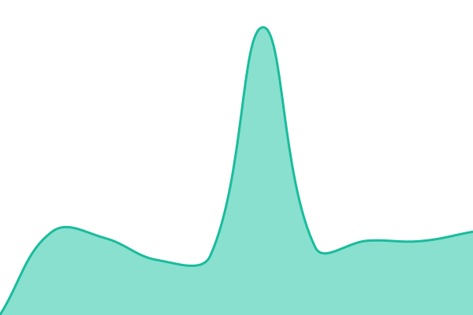

# [📈 Live Status](https://uptime.minenotify.xi.to): <!--live status--> **🟩 All systems operational**

This repository contains the open-source uptime monitor and status page for [LegendYt4k](https://uptime.minenotify.xi.to), powered by [Upptime](https://github.com/upptime/upptime).

With [Upptime](https://upptime.js.org), you can get your own unlimited and free uptime monitor and status page, powered entirely by a GitHub repository. We use [Issues](https://github.com/FreeCode911/minenotify-status/issues) as incident reports, [Actions](https://github.com/FreeCode911/minenotify-status/actions) as uptime monitors, and [Pages](https://uptime.minenotify.xi.to) for the status page.

<!--start: status pages-->
<!-- This summary is generated by Upptime (https://github.com/upptime/upptime) -->
<!-- Do not edit this manually, your changes will be overwritten -->
<!-- prettier-ignore -->
| URL | Status | History | Response Time | Uptime |
| --- | ------ | ------- | ------------- | ------ |
|  [Website](https://minenotify.xi.to/) | 🟩 Up | [website.yml](https://github.com/libinvm20/minenotify-status/commits/HEAD/history/website.yml) | 

 1223ms
     
 | 

<a href="https://uptime.minenotify.xi.to/history/website">71.71%</a>
    

|  [Bot](https://minenotify.xi.to/) | 🟩 Up | [bot.yml](https://github.com/libinvm20/minenotify-status/commits/HEAD/history/bot.yml) | 

 890ms
     
 | 

<a href="https://uptime.minenotify.xi.to/history/bot">71.71%</a>
    

<!--end: status pages-->

[**Visit our status website →**](https://uptime.minenotify.xi.to)

## 📄 License

- Powered by: [Upptime](https://github.com/upptime/upptime)
- Code: [MIT](./LICENSE) © [Anand Chowdhary](https://anandchowdhary.com)
- Data in the `./history` directory: [Open Database License](https://opendatacommons.org/licenses/odbl/1-0/)
